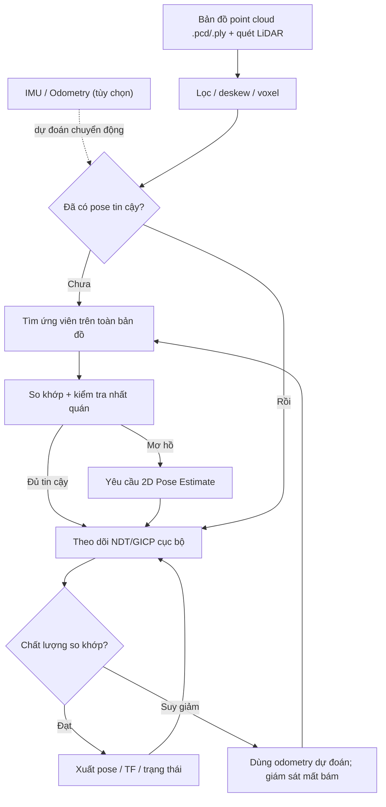

<div align="center">

# VI-LiDAR — Robot tự định vị không cần GPS

**Định vị 3D bằng LiDAR trên bản đồ đám mây điểm có sẵn, dành cho ROS 2 và Nav2.**

[](https://docs.ros.org/en/jazzy/)
[](https://docs.ros.org/en/humble/)
[](LICENSE)

**[Trang giới thiệu / mô phỏng tiếng Việt](index.html)** · **[English README](README.en.md)** · **[Dự án gốc](https://github.com/rsasaki0109/lidar_localization_ros2)**


*Hình động từ thử nghiệm phát lại dữ liệu JEPLO của dự án gốc: Unitree Go2 với Livox MID-360 tìm vị trí trên bản đồ có sẵn. Đây là kết quả chạy ngoại tuyến từ bộ dữ liệu công khai, không phải robot được điều khiển từ website.*

</div>

> **Phạm vi bản Việt hóa:** Repository này giữ nguyên package và thuật toán ROS 2 `lidar_localization_ros2`, bổ sung trang web và README tiếng Việt để phục vụ cộng đồng nghiên cứu robot tự hành. Mã nguồn gốc thuộc [rsasaki0109/lidar_localization_ros2](https://github.com/rsasaki0109/lidar_localization_ros2), sử dụng giấy phép BSD-2-Clause. Tài liệu kỹ thuật chuyên sâu còn ở tiếng Anh và liên kết bên dưới.

## 1. VI-LiDAR dùng để làm gì?

Robot tự hành thường phải biết **tọa độ và hướng (pose)** tương đối với một bản đồ. Khi không có GPS hoặc không muốn nhập `Initial Pose` bằng tay trong RViz, bộ định vị có thể:

1. Nhận bản đồ đám mây điểm 3D đã được xây dựng (`.pcd` hoặc `.ply`).
2. Nhận các lượt quét LiDAR trên robot.
3. Tìm nhiều ứng viên vị trí trên toàn bản đồ (**global localization**).
4. Đánh giá các ứng viên bằng mức độ tương thích với dữ liệu quét và sự nhất quán theo chuyển động.
5. Khi đủ tin cậy, khởi tạo pose và theo dõi liên tục bằng **NDT** (mặc định) hoặc **GICP** (tùy cấu hình).
6. Khi mất bám, phát tín hiệu trạng thái và có thể thực hiện **relocalization** có giám sát.

Robot có thể dùng thêm IMU và odometry để dự đoán chuyển động giữa các lượt quét. **Không cần GPS không có nghĩa là không cần bản đồ**, và tính năng tự tìm vị trí không bảo đảm thành công trong mọi môi trường.

### Định vị không phải SLAM

| Tiêu chí | VI-LiDAR (Localization) | SLAM |
| --- | --- | --- |
| Mục tiêu | Xác định robot đang ở đâu trên bản đồ đã biết | Xây dựng bản đồ song song với định vị |
| Bản đồ ban đầu | Cần bản đồ point cloud tham chiếu | Có thể chưa có |
| Đầu ra | Pose, TF, quỹ đạo, trạng thái đăng ký quét | Bản đồ mới và pose |
| Ứng dụng | AMR/AGV lặp tuyến đường, nhà xưởng, robot bốn chân | Khảo sát, lập bản đồ lần đầu |

## 2. Các chức năng kỹ thuật

- **Global Localization:** tìm kiếm trên toàn bản đồ khi khởi động hoặc mất vị trí khởi tạo.
- **NDT / GICP:** đăng ký đám mây điểm LiDAR với vùng bản đồ gần pose dự đoán; `ndt_omp_ros2` là phụ thuộc chính; `small_gicp` có thể bổ sung cho `SMALL_GICP` / `SMALL_VGICP`.
- **LiDAR + IMU + odometry:** lọc dữ liệu, hỗ trợ bù chuyển động và dự đoán pose khi quét không khớp.
- **Phục hồi có điều kiện:** giám sát điểm tin cậy và chỉ đặt lại pose khi ứng viên đủ thuyết phục; khi mơ hồ có thể yêu cầu thao tác trong RViz.
- **ROS 2 và Nav2:** Jazzy là mục tiêu chính, Humble được hỗ trợ. Foxy đã hết vòng đời và chỉ được duy trì theo khả năng tốt nhất của bản gốc.
- **Tự khám phá topic và TF:** script `quickstart.py` có thể dò nguồn LiDAR, IMU, `/clock` và `odom → base`.

### Luồng xử lý tóm tắt



Đây là sơ đồ diễn giải, không thay thế [sơ đồ triển khai gốc](README.en.md#how-it-works).

## 3. Cài đặt

**Yêu cầu:** Ubuntu/Linux có ROS 2 Jazzy hoặc Humble, bộ dữ liệu LiDAR hoặc cảm biến thật và bản đồ 3D. Công cụ `bootstrap_colcon_workspace.sh` cài/biên dịch các phụ thuộc cần thiết theo cấu hình của dự án.

```bash
mkdir -p ~/lidarloc_ws/src
cd ~/lidarloc_ws/src

# Lấy fork Việt hóa, vẫn giữ tên package ROS 2 gốc:
git clone https://github.com/xulytiengviet/vi-lidar.git lidar_localization_ros2
cd lidar_localization_ros2

scripts/bootstrap_colcon_workspace.sh --build
source ~/lidarloc_ws/install/setup.bash
```

**Quan trọng:** GitHub repository có tên `vi-lidar`, nhưng tên ROS package vẫn là `lidar_localization_ros2`. Không đổi tên package trong lệnh `ros2 run` hoặc `ros2 launch`.

Nếu chưa muốn cài trực tiếp ROS 2, có thể dùng Docker theo hướng dẫn [docs/docker.md](docs/docker.md):

```bash
docker build -f docker/Dockerfile -t lidar_localization_ros2 .
docker run --rm lidar_localization_ros2 \
  /ws/src/lidar_localization_ros2/docker/smoke_status.sh
```

### Chạy định vị trên bản đồ đã có

Trước tiên khởi động driver LiDAR và odometry (nếu có). Thay đường dẫn `/absolute/path/to/map.pcd` bằng tệp bản đồ thật.

```bash
ros2 run lidar_localization_ros2 quickstart.py \
  --map /absolute/path/to/map.pcd
```

Kiểm tra đầu ra và đồ thị ROS:

```bash
ros2 run lidar_localization_ros2 \
  check_lidar_localization_bringup.py --profile standalone
```

`quickstart.py` tự dò topic và TF rồi khởi chạy định vị và RViz. Nếu có pose được lưu cho đúng bản đồ, chương trình thử xác minh và sử dụng lại. Nếu chưa có, hệ thống tìm pose trên toàn bản đồ. Khi không tìm được nghiệm đáng tin cậy, sử dụng **2D Pose Estimate** trong RViz (phím `P`).

Các tùy chọn thường dùng:

| Cờ | Chức năng |
| --- | --- |
| `--dry-run` | In cấu hình dự kiến, không khởi chạy |
| `--profile mid360` | Cấu hình cho Livox MID-360 |
| `--initial-pose X Y Z QX QY QZ QW` | Chỉ định pose đã biết để bỏ qua bước tìm toàn cục |
| `--no-rviz` | Chạy không giao diện đồ họa |
| `--no-status` | Tắt dòng trạng thái |
| `--help-all` | Xem thêm cấu hình tinh chỉnh |

### Unitree Go2 / Livox MID-360

Có thể dùng odometry từ [lidar_slam_ros2](https://github.com/rsasaki0109/lidar_slam_ros2):

```bash
ros2 launch lidarslam rko_lio_odometry.launch.py
ros2 run lidar_localization_ros2 quickstart.py \
  --map /path/to/output/my_map/map.pcd
```

Để khởi chạy cấu hình trực tiếp cho robot bốn chân:

```bash
ros2 launch lidar_localization_ros2 mid360_legged_localization.launch.py \
  map_path:=/absolute/path/to/map.pcd \
  cloud_topic:=/livox/points imu_topic:=/livox/imu
```

**Lưu ý:** Kiểm tra topic thực tế của driver vì tên topic có thể khác. Đọc [hướng dẫn Go2/MID-360 của tác giả](docs/go2_mid360_quickstart.md).

## 4. Nav2, TF và các topic

Khởi chạy ví dụ điều hướng:

```bash
ros2 launch lidar_localization_ros2 nav2_navigation.launch.py \
  map_yaml:=/absolute/path/to/map.yaml
```

Nav2 còn cần bản đồ chiếm chỗ **2D** và nguồn TF `odom → base_link`. Ở chế độ này localizer xuất `map → odom`; ở chế độ độc lập có thể xuất `map → base_link`. Không để nhiều node cùng xuất một cạnh TF.

| Nhóm | Topic mặc định |
| --- | --- |
| Đầu vào | `/cloud`, `/initialpose`, `/odom`, `/imu`, `/map_switch` |
| Đầu ra | `/pcl_pose`, `/path`, `/alignment_status`, `/reinitialization_requested` |
| Trạng thái từ quickstart | `/localization_status/status`, `/localization_status/marker` |

Tham khảo thêm [hợp đồng khung tọa độ](docs/frame_contract.md) và [lưu ý căn chỉnh bản đồ](docs/map_alignment.md).

## 5. Kết quả benchmark và cách hiểu đúng

Dữ liệu dưới đây **được trích từ README nguồn** trong các lượt phát lại ngoại tuyến ở ROS 2 Jazzy, 1×, ngày 06 và 11/10/2026. Mỗi lượt chạy khởi đầu không có pose; sai số được tính trong hệ tọa độ bản đồ, **không căn chỉnh lại quỹ đạo**.

| Bộ dữ liệu | Lượt chạy | Khởi tạo đúng | Sai số trung vị | p95 |
| --- | ---: | ---: | ---: | ---: |
| Koide ngoài trời, MID-360 cầm tay, 4 chuỗi | 12 | 12/12 | 0,08–0,12 m | 0,21–0,91 m |
| Koide ngoài trời, tình huống mang cảm biến sang nơi khác | 6 | 6/6 | 0,04–0,12 m | 15,9–60,5 m |
| JEPLO, Unitree Go2, map từ lidar_slam_ros2, 4 chuỗi | 12 | 12/12 | 0,03 m | 0,09–0,13 m |
| JEPLO Go2, bản đồ rộng, cấu hình low-sensor, 7 chuỗi | 18 | 18/18 | 0,02–0,03 m | Không công bố |

**Không được suy diễn rằng robot luôn đạt 2–3 cm.** Kết quả chỉ áp dụng cho các chuỗi, bản đồ, cảm biến và cấu hình được kiểm thử. Các tình huống “kidnap” có thể có sai số lớn trước khi phục hồi; một số cấu hình hoặc bản đồ đối xứng có thể khiến tìm kiếm toàn cục mơ hồ và phải nhập pose thủ công. Nguồn cũng chưa xác nhận bài kiểm thử chạy robot thật liên tục nhiều giờ.


*Ví dụ Koide ngoài trời riêng biệt có RMSE quỹ đạo khoảng 0,26 m, bắt đầu từ pose ground truth; không nên gộp số liệu này với bài kiểm thử tự khởi tạo.*

Thông tin đầy đủ về kịch bản, dữ liệu và kết quả: [docs/benchmark.md](docs/benchmark.md). Bộ dữ liệu tham khảo: [Koide Hard Point Cloud Localization Dataset](https://zenodo.org/records/10122133) và [JEPLO Dataset](https://huggingface.co/datasets/ASIG-Lab/JEPLO-Dataset).

### Thử nghiệm không cần robot

Sau khi biên dịch package cùng `rko_lio` từ `lidar_slam_ros2`, chạy:

```bash
ros2 run lidar_localization_ros2 run_koide_public_bag.py --download
```

Lệnh tải bộ dữ liệu Koide, chạy phát lại odometry/định vị và xuất sai số so với ground truth. Đọc [hướng dẫn phát lại đầy đủ](docs/koide-online-replay.md); cần internet, dung lượng lưu trữ và môi trường ROS 2 phù hợp.

## 6. Website tiếng Việt và mô phỏng

Tệp [`index.html`](index.html) là trang web tĩnh tự chứa (CSS + JavaScript), dành cho GitHub Pages. Nội dung gồm:

- Giải thích cách robot tự tìm vị trí mà không cần GPS.
- Phân biệt **định vị trên bản đồ** và **SLAM**.
- Trực quan hóa mặt bằng 2D, tia LiDAR, đường đi và các ứng viên vị trí toàn cục.
- Các thao tác **Bắt đầu → Mất định vị → Tìm lại → Đặt lại**.
- Sơ đồ kiến trúc, thông số ROS 2, lệnh chạy và bảng benchmark có giới hạn rõ ràng.

**Mô phỏng web chỉ là minh họa hình học bằng JavaScript**, không gọi ROS 2, NDT hay GICP thật, không chạy cảm biến và không tạo ra số liệu độ chính xác nghiên cứu.

Để xuất bản website, vào **Settings → Pages → Build and deployment**, đặt nguồn **Deploy from a branch**, chọn **main** và thư mục **/(root)**. Khi Pages được bật, địa chỉ dự kiến là:

https://xulytiengviet.github.io/vi-lidar/

Có thể mở `index.html` trực tiếp trong trình duyệt để thử giao diện, nhưng đường dẫn hình minh họa cần giữ đúng cấu trúc repository.

## 7. Hướng dẫn và tài liệu nguồn

| Nội dung | Tài liệu |
| --- | --- |
| Cài đặt nhanh, tự nhận pose | [docs/quickstart.md](docs/quickstart.md) |
| Robot Go2 + Livox MID-360 | [docs/go2_mid360_quickstart.md](docs/go2_mid360_quickstart.md) |
| Tìm vị trí toàn cục và phục hồi | [docs/global_localization.md](docs/global_localization.md) |
| Tính toán chuyển động IMU / deskew | [docs/imu_estimation.md](docs/imu_estimation.md) |
| Đọc pose covariance | [docs/pose_covariance.md](docs/pose_covariance.md) |
| Quy ước TF | [docs/frame_contract.md](docs/frame_contract.md) |
| Xử lý lỗi | [docs/troubleshooting.md](docs/troubleshooting.md) |
| Benchmark và tái lập | [docs/benchmark.md](docs/benchmark.md) |
| Docker | [docs/docker.md](docs/docker.md) |
| Bản README tiếng Anh | [README.en.md](README.en.md) |

## 8. An toàn, giấy phép và ghi công

- **Mã nguồn định vị**: tác giả gốc [rsasaki0109](https://github.com/rsasaki0109/lidar_localization_ros2), giấy phép [BSD-2-Clause](LICENSE); phải giữ thông báo bản quyền và điều khoản của mã nguồn khi tái sử dụng.
- **Việt hóa & giao diện**: dự án [xulytiengviet/vi-lidar](https://github.com/xulytiengviet/vi-lidar).
- **Hình động và datasets**: GIF JEPLO được dẫn xuất từ bộ dữ liệu có giấy phép GPL-3.0, Koide theo CC BY 4.0; bảo lưu các thông tin cấp phép/ghi công riêng như tài liệu gốc.
- **An toàn robot**: cần dừng khẩn cấp, kiểm soát vận tốc, kiểm tra tọa độ/TF và giám sát tình trạng định vị trước khi kích hoạt phần cứng thực.
